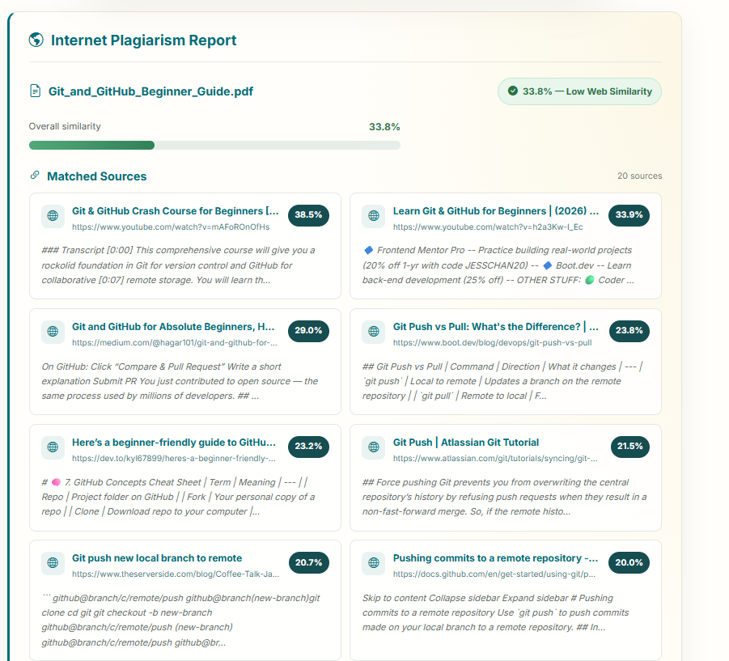
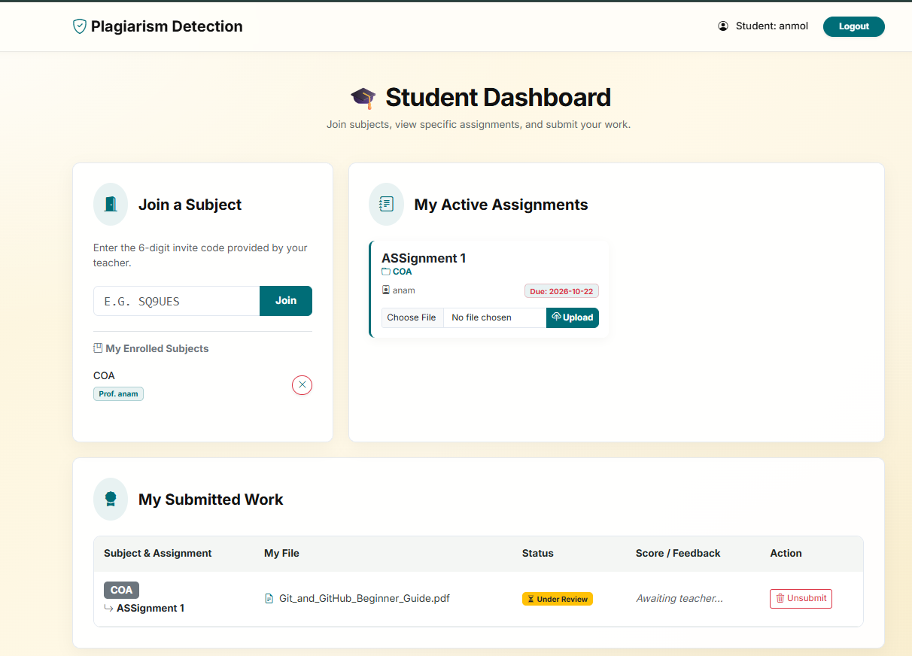
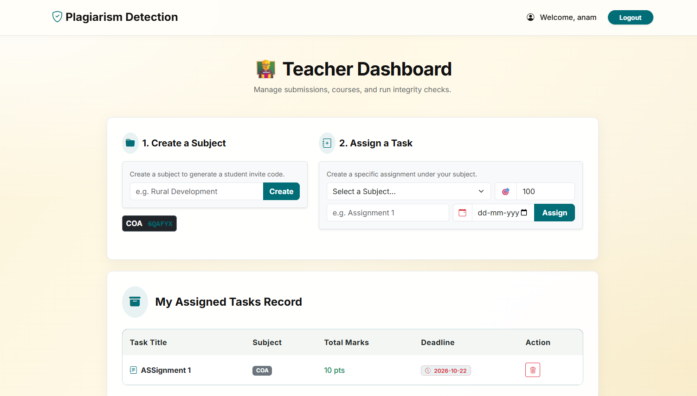

# PlagiarismGuard

> An intelligent, multi-tier academic integrity and plagiarism detection platform built with Python, Flask, SQLite, Sentence Transformers, and Google Gemini.

PlagiarismGuard allows teachers to manage courses and assignments, students to submit work in multiple formats (PDF, DOCX, TXT), and educators to detect plagiarism across three distinct layers:
1. **Peer-to-Peer Semantic Comparison:** Detects paraphrasing and conceptual copying between submitted student files using sentence embeddings.
2. **Global Historical Scan:** Uses the Winnowing algorithm to fingerprint submissions against a central database of past student work.
3. **Multi-Signal Internet Scan:** Searches the web via Tavily, extracts and fetches live web pages in parallel, and scores similarity using an ensemble of n-grams, sequence matching, and sentence-level alignment with baseline topic noise reduction.
4. **AI-Powered Summary & Local Fallback:** Synthesizes matched evidence into an investigator report using Google Gemini, with a deterministic local fallback if offline or unconfigured.

---

## Features

### Teacher Portal
- **Course & Task Management:** Create courses with auto-generated 6-character invite codes; set assignment deadlines and total marks.
- **Submission Tracking & Grading:** Review submitted files, grade out of total marks, and leave feedback for students.
- **Subject-Wide Batch Comparison:** Run an automated matrix comparison across all submissions in a subject with a single click.
- **Deep Inspection:** Side-by-side diff highlighting for both peer comparisons and historical database matches.

### Student Portal
- **Course Enrollment:** Join teacher-created courses instantly using class invite codes.
- **Multi-Format Submissions:** Upload assignments in `.pdf`, `.docx`, or `.txt` formats (up to 16 MB).
- **Feedback & Grades:** Track evaluation status, view awarded marks, and read teacher feedback.

### Multi-Tier Plagiarism Detection Engine
- **Peer Semantic Similarity:** Uses `sentence-transformers` (`all-MiniLM-L6-v2`) to capture conceptual and paraphrased similarity beyond simple keyword matching, complete with color-coded sentence highlighting.
- **Global Winnowing Scan:** Fingerprints documents using k-grams and windowed hash selection (Winnowing). Preserves historical hashes in SQLite so new submissions are checked against all prior student work.
- **Multi-Signal Internet Scan:**
  - Automated query generation from key document sentences and entities.
  - Web search via Tavily API with social-network domain filtering (filters Facebook, Instagram, YouTube, TikTok, X/Twitter, LinkedIn, Pinterest).
  - High-throughput parallel fetching via Tavily Extract and a multithreaded fallback crawler (`ThreadPoolExecutor`).
  - Baseline-adjusted scoring: removes common topic noise (8% baseline) and combines sequence matching (25%), 3-gram overlap (25%), 5-gram overlap (25%), keyword overlap (10%), and best sentence matches (15%).
  - Weighted overall verdict giving 60% weight to the top source and 40% to top-3 average, with an automatic High Plagiarism verdict if any single source matches $\ge 60\%$.
- **AI Investigation Report:**
  - Generates a concise summary naming specific matching URLs using Google Gemini (`gemini-3.8-flash` via `google-genai`).
  - Deterministic offline/timeout fallback ensuring teachers always receive clear evidence even during API outages or rate limits.

---

## Screenshots

| Landing Page | Internet Plagiarism Report | Multi-Document Comparison |
|---|---|---|
|  |  |  |

| Student Dashboard | Teacher Dashboard |
|---|---|
|  |  |

Algorithm performance and complexity benchmarks are available in [`docs/benchmarks/`](docs/benchmarks).

---

## Project Structure

```
plagiarism-checker/
├── run.py                          # Application entry point
├── requirements.txt                # Full Python dependencies (local & benchmarking)
├── requirements-render.txt         # Lightweight deployment dependency set
├── render.yaml                     # Render web service specification
├── .env.example                    # Template for environment variables
├── app/
│   ├── __init__.py                 # Flask application factory (create_app)
│   ├── config.py                   # Configuration and environment loader
│   ├── extensions.py               # Flask-Login initialization
│   ├── db.py                       # SQLite schema, connection, and migrations
│   ├── models.py                   # User model & user loader
│   ├── routes/
│   │   ├── auth.py                 # User authentication (register, login, logout)
│   │   ├── student.py              # Student dashboard, course join, file uploads
│   │   ├── teacher.py              # Teacher dashboard, course/task creation, grading
│   │   └── analysis.py             # Multi-file compare, global scan, subject scan
│   ├── services/
│   │   ├── text_extraction.py      # PDF, DOCX, TXT parsers & text sanitization
│   │   ├── winnowing.py            # K-gram fingerprinting algorithm
│   │   ├── semantic.py             # Sentence Transformers embedding similarity
│   │   ├── internet_scan.py        # Tavily search, parallel fetch, multi-signal scoring
│   │   └── ai_report.py            # Gemini investigator report & local fallback
│   ├── templates/                  # Jinja2 HTML templates
│   └── static/                     # CSS stylesheets, JavaScript, and icons
├── scripts/
│   ├── benchmark.py                # Internet-scan and offline comparison benchmark runner
│   ├── algorithm_comparison.py     # Generates benchmark graphs comparing algorithms
│   ├── benchmark_docs/             # Sample documents for performance testing
│   └── benchmark_results.csv       # Benchmark metrics and timing data
├── docs/
│   ├── benchmarks/                 # Benchmark charts (time complexity, algorithm comparisons)
│   └── screenshots/                # Application UI screenshots
└── instance/                       # Local SQLite database & uploads (git-ignored)
```

---

## Getting Started

### Prerequisites
- Python 3.10+ installed
- Git

### 1. Clone the repository
```bash
git clone https://github.com/<your-username>/plagiarism-checker.git
cd plagiarism-checker
```

### 2. Create and activate a virtual environment
```bash
# On Windows (PowerShell):
python -m venv venv
.\venv\Scripts\activate

# On macOS/Linux:
python3 -m venv venv
source venv/bin/activate
```

### 3. Install dependencies
```bash
pip install -r requirements.txt
```

> [!NOTE]
> The first time peer semantic comparison runs, the application downloads the lightweight `all-MiniLM-L6-v2` Sentence Transformer model (~90 MB) into local cache.

### 4. Configure environment variables
Copy the example environment file:
```bash
# Windows:
copy .env.example .env

# macOS/Linux:
cp .env.example .env
```

Open `.env` and configure your keys:

| Variable | Required | Default | Description |
|---|---|---|---|
| `SECRET_KEY` | Recommended | `dev-only-change-me` | Secret key used to sign session cookies. |
| `GEMINI_API_KEY` | Optional | *empty* | Google Gemini API key for AI summary reports. |
| `GEMINI_MODEL` | Optional | `gemini-3.8-flash` | Gemini model name used for analysis. |
| `GEMINI_TIMEOUT_MS` | Optional | `30000` | Timeout in milliseconds for Gemini API requests (capped at 15000 ms internally). |
| `TAVILY_API_KEY` | Optional | *empty* | Tavily API key for live internet search and page extraction. |
| `DATABASE_PATH` | Optional | `instance/database.db` | Path to the SQLite database file. |
| `UPLOAD_FOLDER` | Optional | `instance/uploads` | Directory where uploaded assignments are stored. |

> [!TIP]
> The application runs completely without API keys! Offline peer comparison, subject-wide scans, and global Winnowing scans remain fully functional. If Tavily or Gemini keys are omitted, the internet scan gracefully notifies the user and AI summaries use the built-in local deterministic fallback.

### 5. Run the application
```bash
python run.py
```

Open your browser and navigate to `http://127.0.0.1:5000`.

---

## Benchmarks & Performance

PlagiarismGuard includes built-in benchmarking utilities to test accuracy, scalability, and latency.

### Running Benchmarks
Place sample test documents in `scripts/benchmark_docs/` (`.pdf`, `.docx`, or `.txt`), then run:

```bash
# Run full benchmark (offline + internet scan metrics):
python scripts/benchmark.py

# Run offline benchmarks only (no Tavily credits consumed):
python scripts/benchmark.py --skip-internet

# Run on a limited number of documents:
python scripts/benchmark.py --max-docs 5
```

Benchmark results and latency metrics (query counts, pages rescued via Tavily Extract, blocked pages, scoring duration) are exported to `scripts/benchmark_results.csv`.

### Regenerating Complexity and Comparison Charts
```bash
python scripts/algorithm_comparison.py
```
This regenerates the visual charts in `docs/benchmarks/`:
- `algorithm-comparison.png`: Comparison of Winnowing vs. SequenceMatcher vs. Semantic Embeddings across varying similarity levels.
- `time-complexity.png`: Execution time scaling across document sizes.

---

## Production Deployment (Render)

The repository includes a ready-to-use [`render.yaml`](./render.yaml) configuration.

### Deploying to Render
1. Push your repository to GitHub or GitLab.
2. In the Render Dashboard, create a new **Blueprint** and link your repository.
3. Render automatically picks up `render.yaml`:
   - Installs dependencies from `requirements-render.txt`.
   - Starts Gunicorn: `gunicorn --workers 1 --threads 4 --timeout 120 run:app`.
   - Sets the health check endpoint to `/health`.
4. In the Render dashboard, add your environment variables (`SECRET_KEY`, `TAVILY_API_KEY`, `GEMINI_API_KEY`).

### Keeping Free Render Instances Warm
Render free-tier instances spin down after 15 minutes of inactivity. To mitigate cold starts:
1. PlagiarismGuard provides a lightweight, database-free `/health` endpoint designed specifically for uptime checks.
2. Configure a free uptime monitor (e.g., [UptimeRobot](https://uptimerobot.com/) or [cron-job.org](https://cron-job.org/)):
   - **URL:** `https://<your-service-name>.onrender.com/health`
   - **Check Interval:** Every 5 to 10 minutes.
   - **Method:** `GET` or `HEAD` (returns HTTP 200 `{"status": "ok"}`).
3. The frontend includes automatic exponential backoff retry mechanisms to wake up sleeping instances when users access pages.

---

## Supported File Types

- **Adobe PDF** (`.pdf`)
- **Microsoft Word** (`.docx`)
- **Plain Text** (`.txt`)
- Upload limit: 16 MB per file (configurable via `MAX_CONTENT_LENGTH`).

---

## License

MIT License
